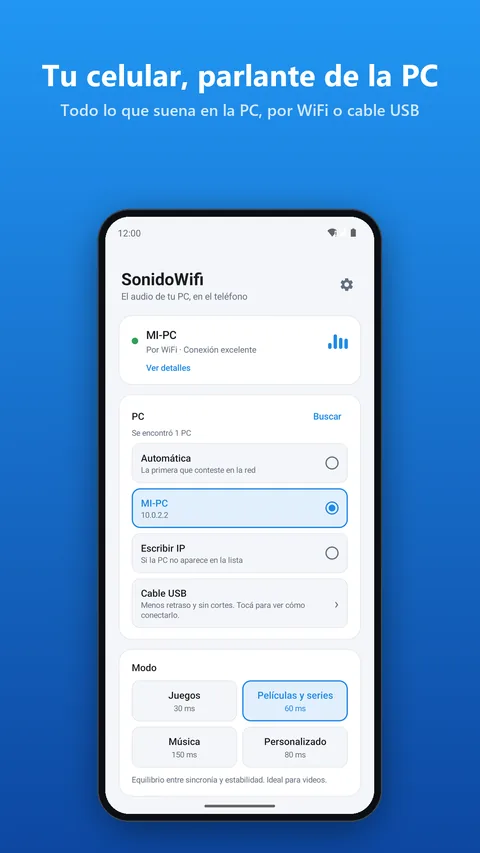
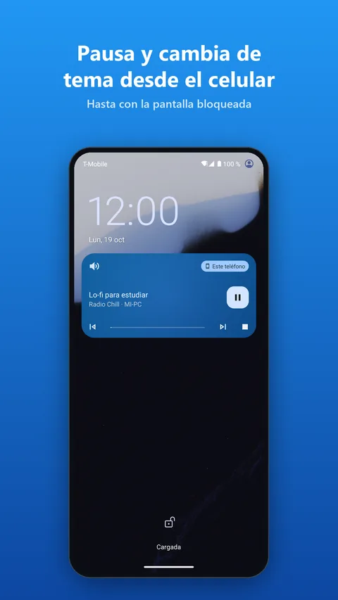
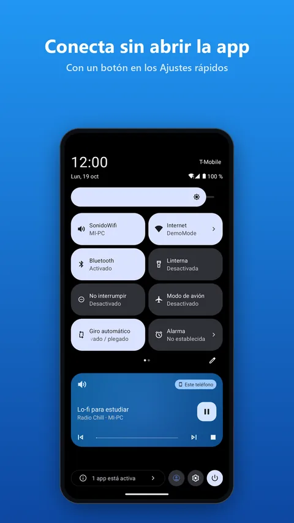

# SonidoWifi

**Usá tu celular Android como parlante de la PC — por WiFi o cable USB, con poco retraso. Gratis.**
**Use your Android phone as a PC speaker — over Wi-Fi or USB cable, with low delay. Free.**

🌐 **https://parkerbfb.github.io/sonidowifi-web/**

  
  
  

## Descargar · Download

| | Windows 10 / 11 | Android 7+ |
|---|---|---|
| **Descarga directa · Direct download** | [SonidoWifi.exe](../../releases/latest/download/SonidoWifi.exe) | [SonidoWifi.apk](../../releases/latest/download/SonidoWifi.apk) |
| **Tiendas · Stores** | Microsoft Store (pronto · soon) | Google Play (pronto · soon) |

Instalá las dos, abrí SonidoWifi en la PC y tocá **Conectar** en el teléfono (o escaneá el QR que
muestra la PC con la cámara). · Install both, open SonidoWifi on the PC and tap **Connect** on the
phone (or scan the QR code shown by the PC with the camera).

## Qué hace · What it does

- 🎧 **Todo el audio de la PC en el teléfono** (juegos, películas, YouTube, Spotify, Discord) o en
  tus auriculares Bluetooth, aunque la PC no tenga Bluetooth. · **All of the PC's audio on your
  phone** or your Bluetooth headphones, even if the PC has no Bluetooth.
- ⚡ **Poco retraso**: modos Juegos (30 ms), Películas, Música o el que elijas; por cable USB, aún
  menos. · **Low delay**: Games (30 ms), Movies, Music or custom; even lower over USB.
- ⏯️ **Manejá la PC desde el teléfono**: pausa, siguiente y anterior desde la notificación, la
  pantalla de bloqueo o los auriculares, y mirá qué está sonando. · **Control the PC from your
  phone**: pause, next, previous and what's playing.
- 👥 **Varios teléfonos a la vez**, 🔊 **volumen extra**, 🔒 **permiso para teléfonos nuevos**,
  🌍 **19 idiomas**. · **Several phones at once**, **extra volume**, **permission for new phones**,
  **19 languages**.
- 🆓 **Gratis, sin anuncios, sin cuentas, sin límites de tiempo.** El audio no sale de tu red. ·
  **Free, no ads, no accounts, no time limits.** Audio never leaves your network.

Este repositorio contiene el sitio de descarga y las versiones publicadas (Releases). · This
repository hosts the download site and the published releases.

[Política de privacidad / Privacy policy](https://parkerbfb.github.io/sonidowifi-web/privacidad.html) ·
Contacto / Contact: samuelfurtado86@gmail.com

© 2026 Boris Furtado.
